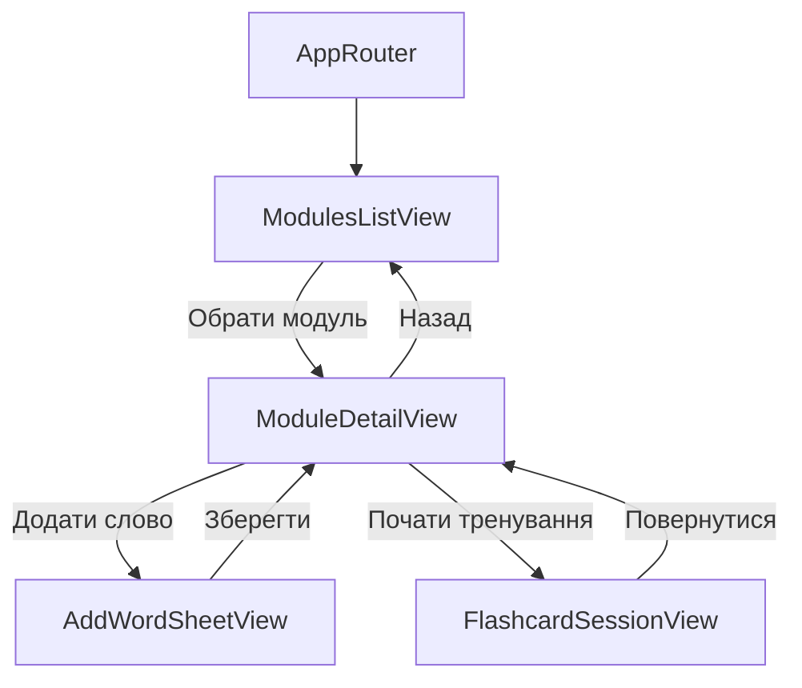

# Wordios

**Wordios** — навчальний iOS-застосунок для вивчення англійських слів за тематичними картками (A1–C2). Створено на Swift та SwiftUI з використанням MVVM і патернів проєктування.

## Практична №1 — Моделі Swift

- `WordCard` із перекладом, необов'язковою транскрипцією, синонімами і статусом.
- `WordModule` з додаванням, пошуком і фільтрацією слів та розрахунком прогресу.
- `DemoData` містить демонстрацію модуля «Подорожі» (A2, 10 слів).

## Практична №2 — MVVM та патерни

- `DictionaryRepositoryProtocol` і `MockDictionaryRepository` забезпечують офлайн-сховище.
- `ModulesListViewModel` керує списком тем та фільтром за рівнями.
- `FlashcardSessionViewModel` керує сесією і зберігає статус картки через репозиторій.
- Реалізовані **Builder**, **Strategy** та **Adapter** (`DictionaryWordAdapter`).
- Діаграма та аналіз SOLID — у [`docs/architecture.md`](docs/architecture.md).

## Практична №3 — SwiftUI, навігація та робота з формами

Нові компоненти:

- `Sources/Navigation/AppRouter.swift`: центральна навігація через `NavigationView` (сумісна з iOS 15.5 / Xcode 13.4.1).
- `Sources/Views/ModulesListView.swift`: список тем, фільтрація A1–C2, прогрес кожного модуля.
- `Sources/Views/ModuleDetailView.swift`: список слів, транскрипції, синоніми, їх порівняння та запуск тренування.
- `Sources/Views/AddWordSheetView.swift`: додавання слова через `.sheet`, перевірка обов'язкових полів, захист від дублікатів і можливість збереження при відкритій клавіатурі.
- `Sources/Views/FlashcardSessionView.swift` і `FlashcardCardView.swift`: інтерфейс тренування; використовують спільну ViewModel з практичної №2 замість дублювання класів.
- `Sources/Models/AdditionalDemoModules.swift`: набори **«Робота й кар'єра» (B1)** та **«Наука й технології» (C1)** по 10 слів кожен. Набір A2 також має 10 слів.

### Карта навігації

**AppRouter** визначає переходи, а екрани надсилають події через замикання. Дані живуть у спільному `MockDictionaryRepository`; після додавання слова та позначення картки прогрес і список оновлюються через ViewModel.

### Сценарій користувача

1. Відкрити Wordios і переглянути тематичні модулі.
2. Вибрати рівень `A2`, `B1` або `C1` (також доступні інші рівні з порожнім станом).
3. Відкрити модуль і переглянути список карток із транскрипцією та синонімами.
4. За потреби порівняти синоніми двох слів.
5. Натиснути `+`, заповнити форму й зберегти слово. Нове слово одразу з'явиться у списку.
6. Обрати «Почати тренування», перевертати картки, позначати їх «Ще вчу» або «Вивчено».
7. Повернутися до модуля: відсоток вивчених слів оновиться.

### Запуск і перевірка

1. Відкрити `Wordios.xcodeproj` у Xcode 13.4.1 або новішому.
2. Перевірити target membership усіх файлів `Sources/`, `Wordios/` і `WordiosTests/`.
3. Обрати iOS Simulator, виконати **Product → Build** (`⌘B`), а потім **Product → Test** (`⌘U`).
4. Перевірити ручний сценарій із [`docs/practical3-checklist.md`](docs/practical3-checklist.md).

Поточне сховище — **in-memory**, тому додані слова та змінені статуси скидаються після перезапуску застосунку. Постійне зберігання й реальне API заплановані на практичну №4.

### Скриншоти екранів

Після запуску в iOS Simulator додайте скриншоти в `docs/screenshots/`:
`modules-list.png`, `module-detail.png`, `add-word.png`, `training.png`.
Зображення ще не додані, оскільки потрібні фактичні скриншоти протестованої збірки.

## Робота з Git

Розробка ведеться в гілках `feat/...` із Pull Request у `main`. Тег `practical-3` слід створити **після** злиття і перевірки обох частин практичної №3 у `main`, а не в окремій робочій гілці.
