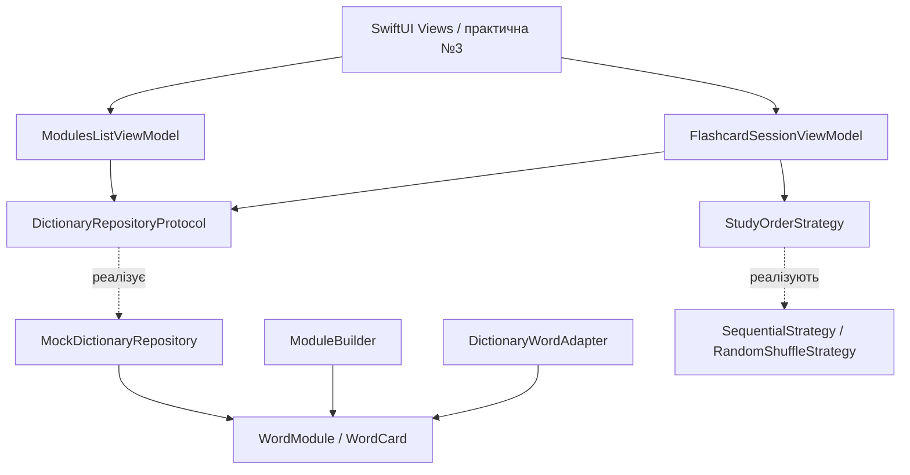

# Wordios — практична робота №2: MVVM, патерни та SOLID

## Мета й структура

Проєкт організовано за **MVVM (Model–View–ViewModel)**. `Models` містить `WordCard`, `WordModule` та перелічення; `ViewModels` готує дані й обробляє дії інтерфейсу; `Views` (будуть додані в практичній №3) лише відображають стан і передають події. `Services` надає доступ до даних через протокол, `Patterns` містить Builder, Strategy та Adapter.

## Схема взаємодії

**Потік даних:** View передає дію у ViewModel → ViewModel викликає метод протоколу репозиторію → сховище оновлює `WordModule`/`WordCard` → ViewModel оновлює `@Published`-стан → SwiftUI перемальовує View. У тренуванні ViewModel також викликає передану Strategy, щоб встановити початковий порядок карток.

## Три патерни проєктування

| Патерн | Задача | Учасники | Місце в коді |
|---|---|---|---|
| **Builder** (породжувальний) | Покроково сконструювати модуль із назвою, рівнем і картками | `ModuleBuilder` → `WordModule` | `Sources/Patterns/ModuleBuilder.swift` |
| **Strategy** (поведінковий) | Вибирати порядок тренування без змін ViewModel | `StudyOrderStrategy`, `SequentialStrategy`, `RandomShuffleStrategy`, `FlashcardSessionViewModel` | `Sources/Patterns/StudyOrderStrategy.swift` |
| **Adapter** (структурний) | Перетворити сирий словниковий запис на `WordCard`, підготувати синоніми до порівняння | `RawDictionaryWord`, `DictionaryWordAdapter`, `WordCard` | `Sources/Patterns/DictionaryWordAdapter.swift` |

Приклад Adapter: рядок `" Trip, journey; trip "` перетворюється на `['Trip', 'journey']`; для порівняння синоніми приводяться до нижнього регістру, усуваються повтори й сортуються. `synonymsMatch` порівнює набори незалежно від порядку та регістру.

## SOLID

- **S — Single Responsibility:** `WordCard` зберігає стан слова; `DictionaryWordAdapter` перетворює формат; репозиторій керує сховищем; ViewModel містить стан екрана. Обов'язки розділені.
- **O — Open/Closed:** нову стратегію порядку можна додати через реалізацію `StudyOrderStrategy`, не змінюючи `FlashcardSessionViewModel`.
- **L — Liskov Substitution:** будь-яку коректну реалізацію `DictionaryRepositoryProtocol` можна передати замість `MockDictionaryRepository`; будь-яку Strategy — замість наявних двох. Замінні реалізації мають дотримуватися контрактів.
- **I — Interface Segregation:** `StudyOrderStrategy` має лише вимоги до впорядкування карток; ViewModel тренування не зобов'язана залежати від API Builder чи Adapter. `DictionaryRepositoryProtocol` поки охоплює п'ять близьких операцій, а за ускладнення функцій його можна розділити.
- **D — Dependency Inversion:** обидві ViewModel отримують `DictionaryRepositoryProtocol` через ініціалізатор, а `FlashcardSessionViewModel` додатково отримує `StudyOrderStrategy`. Вони не створюють конкретні сервіси всередині себе.

## Уникнення антипатернів

**Massive View:** логіка пошуку, сортування, оновлення прогресу й збереження не записується в SwiftUI View, а винесена до ViewModel, моделей і сервісів.

**Жорстка зв'язність:** ViewModel не викликають `MockDictionaryRepository()` усередині себе — залежність передається ззовні (Dependency Injection).

**Дублювання логіки:** обрахунок прогресу реалізовано в `WordModule.calculateProgress()` і повторно використовується у ViewModel.

## Демонстрація й перевірка

У практичній №2 використовується один офлайн-набір **«Подорожі» (A2), 10 слів**. Додаткові тематичні набори плануються на практичну №3. `MockDictionaryRepository` зберігає зміни лише в пам'яті процесу; мережа не використовується. Додати або змінити картку можна через методи протоколу репозиторію. Для майбутнього API можна створити іншу реалізацію цього протоколу.

На Windows компілюється базова логіка Swift, але SwiftUI та `Combine` ViewModel потрібно остаточно збирати в Xcode на macOS. В інтеграційних перевірках варто перевірити порожній список, додавання картки, зміну статусу, прогрес і дві стратегії порядку.

## Обмеження поточної версії

- Немає постійного збереження даних між перезапусками.
- Підтримується один початковий модуль; UI додається в практичній №3.
- `WordModule` — посилальний тип (`class`), тому ViewModel явно перевидають `@Published`-стан після змін через репозиторій.
- У поточному протоколі операції зміни повертають `Void`; наявність неіснуючого модуля не спричиняє помилки. Для реального API потрібен явний результат або `throws`.

## Процедура Git

Створити нову гілку від актуальної `main`, наприклад `feat/mvvm-integration`. Після компіляції створити коміт, запушити гілку, відкрити Pull Request у `main` і отримати рев'ю Крістіни. **Тег `practical-2` створювати лише після злиття обох частин роботи в `main`.**
